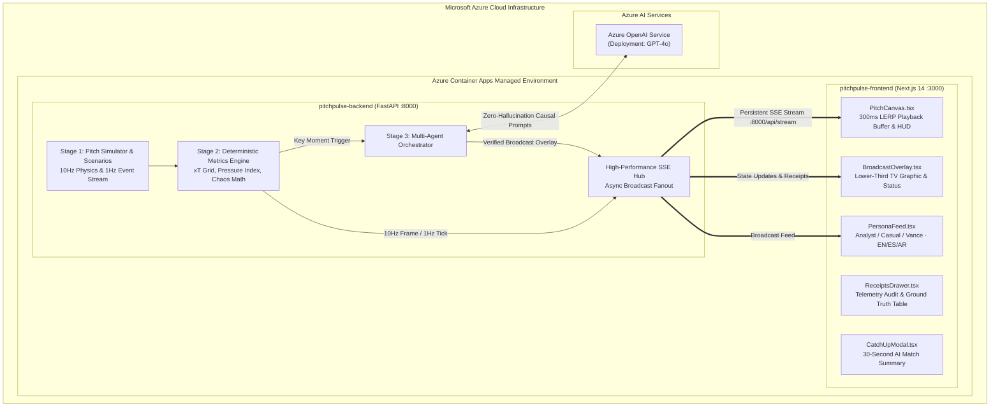

# PitchPulse Studio ⚽⚡

> **Containerized Real-Time Match Intelligence & Multi-Agent Telemetry Engine**  
> *Target Challenge: Microsoft & Premier League "Inside the Game: Developer Hackathon"*

[](https://azure.microsoft.com/services/container-apps/)
[](https://azure.microsoft.com/products/ai-services/openai-service/)
[](https://fastapi.tiangolo.com)
[](https://nextjs.org)
[](https://tailwindcss.com)

---

## 1. Executive Summary & Problem Statement

### The Problem
Every generic hackathon entry pipes raw match event JSON into an unchecked LLM prompt, producing descriptive banalities (*"Player 8 made a pass"*) or generating ungrounded hallucinations (*"Arsenal haven't had a shot on target all half"* when they had three). Live television broadcasters (**Sky Sports, TNT Sports, Premier League Productions**) and global streaming platforms cannot put unverified AI on air. Factual inaccuracies destroy broadcast credibility.

### The PitchPulse Solution: "Studio Receipts"
**PitchPulse Studio** implements the mandatory 5-stage hackathon pipeline anchored by a deterministic spatial metrics engine and a 3-agent **Narrator-Verifier-Persona** architecture:

1. **Ingest (Stage 1):** Streams synthetic match events at 10Hz with 2D pitch coordinates via Server-Sent Events (SSE), backed by a deterministic Scenario Injector.
2. **Interpret (Stage 2):** Deterministic Python mathematics computes spatial metrics without LLM speculation:
   - Expected Threat Delta ($\Delta xT$) across an $8 \times 12$ calibrated grid
   - Pass Difficulty & Pressure Index ($0-100\%$)
   - Ball & Sprint Speeds ($km/h$)
   - Rolling Control vs. Chaos Index ($0-100$)
3. **Explain & Verify (Stage 3 — The Agentic Core):**
   - **Narrator Agent (Azure OpenAI GPT-4o):** Formulates tactical explanations of why moments matter strictly from computed mathematical facts.
   - **Studio Verifier Agent:** Cross-examines every entity name, metric, and spatial direction in the draft against ground-truth telemetry IDs. Emits a verifiable audit trail (`PASSED`) or triggers automated self-correction before emission.
   - **Persona & Localization Router:** Simultaneously rewrites verified insights for **Tactical Analyst**, **Casual Fan**, and **Dynamic 22-Player Focus** viewing modes across **7 global broadcast languages**: English (EN), Spanish (ES), Arabic (AR), Korean (KO), French (FR), Portuguese (PT), and German (DE).
4. **Render (Stage 4):** Emits standardized, frame-accurate Broadcast Overlay JSON payloads triggering television lower-third graphics over an interactive 2D HTML5 tactical pitch canvas with a 300ms jitter-proof LERP playback buffer, real-time **Voronoi pitch dominance space-control mesh**, and **Live Audio Commentary Synthesis**.
5. **Personalize & Audit (Stage 5):** The client provides a clickable **Telemetry Receipts Drawer** displaying exact source Event IDs, defender distance vectors, and verification audit trails, an **AI Vision Auto-Eventing & Homography Inspector**, plus an instant **"Whole-Game Tactical Recap (1'-90')"** timeline generator.

---

## 2. Cloud Architecture Diagram



---

## 3. The Narrator-Verifier Guardrail Pattern

Broadcasters require mathematically verifiable confidence before any graphic hits the television screen. PitchPulse Studio enforces an audit loop:

```mermaid
sequenceDiagram
    autonumber
    participant Engine as Deterministic Physics Engine
    participant Narrator as Agent 1: Narrator (Azure GPT-4o)
    participant Verifier as Agent 2: Studio Verifier
    participant Router as Agent 3: Persona Router
    participant Broadcast as Master Broadcast Deck

    Engine->>Narrator: Raw Event & Computed Metrics (e.g. Bypassed=2, xT=+0.34)
    Narrator->>Verifier: Draft Narrative (Asserts: "Bypassed 4 defenders...")
    Note over Verifier: Cross-examines assertions against ground truth telemetry IDs
    alt Assertion matches ground truth
        Verifier->>Router: Verified Narrative (Confidence: 100%, Status: MATCH)
    else Mismatch / Hallucination Detected
        Note over Verifier: Replaces 4 with 2; Flags status=CORRECTED in Receipt
        Verifier->>Router: Auto-Corrected Narrative + Audit Receipt
    end
    Router->>Broadcast: BroadcastOverlayPayload (Analyst / Casual / Vance in EN/ES/AR)
    Broadcast-->>Broadcast: Lower-third graphic & Telemetry Receipts Drawer
```

### Deterministic Metric Formulas

$$\Delta xT = xT(\text{end\_x}, \text{end\_y}) - xT(\text{start\_x}, \text{start\_y})$$

$$\text{pressure\_index} = \min(100.0, \max(0.0, 100.0 \times \exp(-0.45 \times \text{nearest\_defender\_dist\_m})))$$

$$\text{pass\_difficulty} = \min\left(99.0, \max\left(5.0, 0.35 \cdot P + 0.30 \cdot \left(\frac{D}{45} \cdot 100\right) + 0.25 \cdot (B \cdot 22) + 0.10 \cdot S\right)\right)$$

Where $P$ is Pressure Index, $D$ is distance in meters, $B$ is defenders bypassed, and $S$ is ball speed ($km/h$).

---

## 4. Strict Trademark & Fictional Clubs Compliance

Per hackathon guidelines, all team names, player likenesses, and club crests are 100% fictional:

| Club Identity | Color Tokens | Formation | Star Player (Player-Cam) |
|---|---|---|---|
| **North London Red (NLR)** | `#EF4444` (Crimson), `#FFFFFF` | 4-3-3 Attacking | **#8 Marcus Vance** (Playmaker / AM) |
| **Merseyside Blue (MSB)** | `#3B82F6` (Royal Blue), `#FACC15` | 4-3-3 Mid-Block | **#9 D. Calvert-Sim** (CF) |

---

## 5. Local Setup & Docker Deployment

### Prerequisites
- [Docker Desktop](https://www.docker.com/products/docker-desktop/) installed and running.
- (Optional) Azure OpenAI Service API Key and Endpoint if running live GPT-4o calls.

### Single-Command Launch
```bash
# Clone the repository
git clone https://github.com/Vali-Hameed/PitchPulse.git
cd PitchPulse

# (Optional) Provide Azure OpenAI credentials
cp backend/.env.example backend/.env
# Edit backend/.env if you have Azure keys; otherwise local deterministic fallback runs instantly!

# Build and start containerized frontend & backend
docker compose up --build
```

- **Frontend Broadcast Deck:** [http://localhost:3000](http://localhost:3000)
- **FastAPI SSE & REST API:** [http://localhost:8000](http://localhost:8000)
- **Engine Health Endpoint:** [http://localhost:8000/api/health](http://localhost:8000/api/health)

### Running Automated Test Suite Inside Container
```bash
docker compose run --rm backend pytest
```

---

## 6. Azure Container Apps (ACA) Deployment Guide

PitchPulse Studio includes an automated PowerShell script (`infra/deploy-aca.ps1`) for single-command deployment to Microsoft Azure:

```powershell
# Authenticate with Azure CLI
az login

# Run automated deployment
./infra/deploy-aca.ps1 `
    -ResourceGroup "rg-pitchpulse-studio" `
    -Location "westus3" `
    -AzureOpenAiKey "<YOUR_AZURE_KEY>" `
    -AzureOpenAiEndpoint "https://<YOUR_RESOURCE>.openai.azure.com/" `
    -AzureOpenAiDeployment "gpt-4o"
```

The script automatically:
1. Provisions Azure Container Registry (ACR) and ACA Managed Environment.
2. Builds and pushes production container images.
3. Sets up HTTPS ingress for both services and wires CORS.
4. Outputs the public live broadcast control deck URL.

---

## 7. License & Fair Play
Built strictly for the Microsoft & Premier League "Inside the Game: Developer Hackathon". Uses 100% synthetic football telemetry, fictional player likenesses, and custom mathematical models. Distributed under the MIT License.