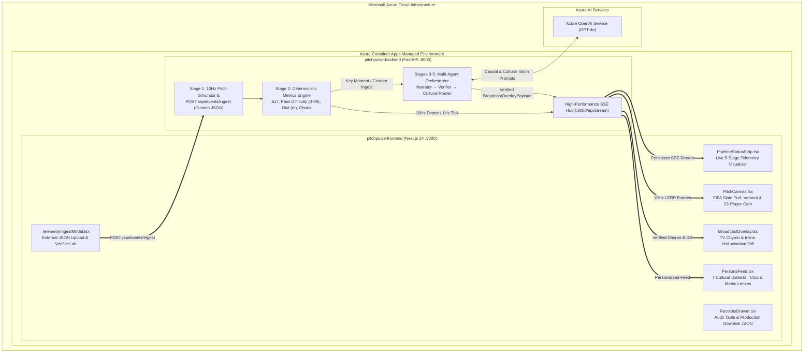
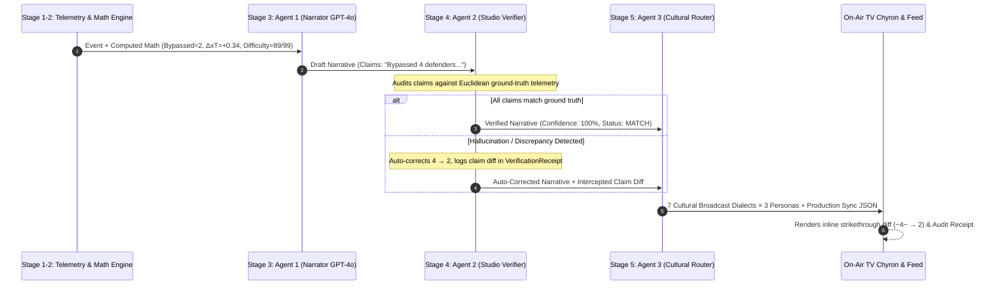

<div align="center">

# PitchPulse Studio

> **Containerized Real-Time Match Intelligence, Cultural Broadcast Adaptation & Multi-Agent Verification Engine**  
> *Built for the Microsoft & Premier League "Inside the Game: Developer Hackathon"*

<br />


</div>
<hr />

## 1. Executive Summary & Problem Positioning

### Why Standard AI Match Commentary Fails in Live Broadcasts
1. **Unverified Hallucinations Destroy Credibility:** Piping raw match event JSON into an unchecked LLM prompt yields factual hallucinations (*"bypassed 4 defenders"* when telemetry shows 2). Live broadcasters (**Sky Sports, TNT Sports, Premier League Productions**) cannot put unverified AI on air.
2. **Literal Translation Feels Robotic:** Word-for-word translation fails global football fans. A viewer in Madrid expects *LaLiga* tactical radio cadence, a viewer in Munich expects *Bundesliga* `Halbraum` & `Gegenpressing` analysis, and a UK viewer expects *Monday Night Football* studio punditry.
3. **One-Size-Fits-None Graphics:** Data-hungry tactical analysts, casual fans, club supporters, and single-metric trackers all receive the exact same static TV graphic.

### The PitchPulse Solution: Verifiable "Studio Receipts" & Cultural Personalization
**PitchPulse Studio** is a production-ready **Obsidian Broadcast Studio** console that executes the mandatory 5-stage hackathon pipeline in real time—visibly illuminated on screen for every event:

1. **Stage 1 — Ingest (`10Hz SSE + Custom JSON Ingest API`):** Streams 22-player synthetic tracking and ball physics at 10Hz via Server-Sent Events (`/api/stream`), backed by 5 deterministic scenario triggers and an interactive **Custom Synthetic Telemetry JSON Ingest Lab (`POST /api/events/ingest`)** that accepts external `.json` feeds or custom spatial coordinates on the fly.
2. **Stage 2 — Interpret (`Deterministic Spatial Mathematics`):** Computes explainable football metrics in pure Python/NumPy without LLM guesswork:
   - **Expected Threat Delta ($\Delta xT$)** across a calibrated $8 \times 12$ transition grid
   - **Pass Difficulty Rating ($0\text{–}99$)** & **Spatial Pass Distance ($m$)**
   - **Defender Pressure Index ($0\text{–}100\%$)** & **Ball/Sprint Velocity ($\text{km/h}$)**
   - **Rolling Control vs. Chaos Index ($0\text{–}100$)** & **Final-Third Territory Dominance ($\%$)**
3. **Stage 3 — Explain (`Agent 1: Azure OpenAI GPT-4o Narrator`):** Synthesizes causal explanations of *why* a moment matters strictly from computed spatial facts.
4. **Stage 4 — Verify & Render (`Agent 2: Studio Verifier + TV Chyron`):** Cross-examines every numerical claim and entity in the draft against ground-truth telemetry before broadcast. If a discrepancy is detected, Agent 2 auto-corrects the copy and renders an **inline strikethrough diff** (`~Bypassed 4 defenders~ → 2`) directly on the main TV chyron and emits a machine-readable **Production Path Overlay Downlink JSON (`pl.studio.overlay.v2`)**.
5. **Stage 5 — Personalize (`Agent 3: Cultural Broadcast Idiom & Lens Router`):** Simultaneously adapts verified intelligence across:
   - **3 Viewing Modes:** `Tactical Analyst`, `Casual Fan`, and `Dynamic 22-Player Cam` (tailored to whichever of the 22 players the viewer selects on the pitch).
   - **7 Cultural Broadcast Dialects:** Authentic regional idioms (UK *Sky MNF*, España/LatAm *Pizarra Táctica*, MENA *beIN Studio*, Korea *SPOTV*, France *Canal+*, Brasil *Mesa Tática*, DACH *Bundesliga Taktik-Feed*).
   - **Club Perspective Lens (`ALL` / `NLR` / `MSB`) & Single Performance Metric Lens (`ΔxT` / `Pass Difficulty` / `Pressure` / `Speed`)**.

---

## 2. Alignment with Official Hackathon Judging Rubric

| Judging Criterion (20% Each) | How PitchPulse Studio Delivers |
|---|---|
| **1. Technological Implementation (20%)** | Containerized FastAPI + Next.js 14 architecture with 10Hz SSE fanout, 300ms LERP canvas interpolation, Azure OpenAI GPT-4o integration with `<2.5s` SLA fallback, automated pytest suite, and one-command Azure Container Apps (`infra/deploy-aca.ps1`) deployment. |
| **2. Agentic Design & Innovation (20%)** | 3-Agent **Narrator → Studio Verifier → Cultural Persona Router** pipeline. The Studio Verifier deterministically intercepts and auto-corrects LLM hallucinations before broadcast, exposing both an inline strikethrough diff and a cryptographic-style telemetry audit receipt. |
| **3. Real-World Impact & Applicability (20%)** | Solves the #1 barrier preventing live sports broadcasters from adopting Generative AI (on-air factual reliability) while emitting machine-readable `pl.studio.overlay.v2` JSON ready for Vizrt / Ross Video / HTML5 production graphics pipelines. |
| **4. User Experience & Presentation (20%)** | High-craft **Obsidian Broadcast Studio** UI featuring a live 5-Stage Pipeline Visualizer strip, TV Split Scorebug, regulation FIFA 2D slate-turf pitch with Voronoi space control & xT heatmaps, F1-style linear telemetry instruments, and multilingual Web Speech synthesis. |
| **5. Adherence to Hackathon Category (20%)** | 100% synthetic, trademark-clean Premier League studio engine implementing all 5 pipeline stages, Pass Difficulty/Distance ratings, AI Vision Homography auto-eventing (`/api/vision/inspect`), 30-second catch-up recaps, and multi-dimensional fan personalization. |

---

## 3. Cloud & Multi-Agent Architecture



---

## 4. The Narrator–Verifier Guardrail Pattern

Broadcasters require mathematically verifiable confidence before any graphic hits the television screen. PitchPulse Studio enforces a deterministic audit loop:



### Deterministic Metric Formulas

$$\Delta xT = xT(x_{\text{end}}, y_{\text{end}}) - xT(x_{\text{start}}, y_{\text{start}})$$

$$\text{Pressure Index} = \min\left(100.0, \max\left(0.0, 100.0 \times \exp(-0.45 \times d_{\text{def}})\right)\right)$$

$$\text{Pass Difficulty} = \min\left(99.0, \max\left(5.0, 0.35 \cdot P + 0.30 \cdot \left(\frac{D}{45} \cdot 100\right) + 0.25 \cdot (B \cdot 22) + 0.10 \cdot S\right)\right)$$

Where $P$ is Pressure Index ($0\text{–}100\%$), $D$ is spatial pass distance in meters, $B$ is defenders bypassed, $S$ is ball speed ($\text{km/h}$), and $d_{\text{def}}$ is nearest defender distance in meters.

---

## 5. Strict Trademark & Synthetic Data Compliance

Per hackathon rules, all match telemetry is 100% synthetic and all club/player identities are fictional:

| Club Identity | Color Tokens | Tactical Setup | Spotlight Star (22-Player Cam) |
|---|---|---|---|
| **North London Red (NLR)** | `#E11D48` (Crimson) | 4-3-3 High Possession | **#8 M. Vance-Sim** (Playmaker / AM) |
| **Merseyside Blue (MSB)** | `#2563EB` (Royal Cobalt) | 4-3-3 Compact Mid-Block | **#9 D. Calvert-Sim** (Center Forward / CF) |

---

## 6. Quick Start & Docker Deployment

### Prerequisites
- [Docker Desktop](https://www.docker.com/products/docker-desktop/) installed and running.
- *(Optional)* Azure OpenAI Service API Key and Endpoint for live GPT-4o generation (runs out-of-the-box with zero configuration using the deterministic cultural engine if omitted).

### Single-Command Launch
```bash
# Clone the repository
git clone https://github.com/Vali-Hameed/PitchPulse.git
cd PitchPulse

# (Optional) Configure Azure OpenAI credentials
cp backend/.env.example backend/.env

# Build and start containerized frontend (:3000) & backend (:8000)
docker compose up --build -d
```

- **Studio Broadcast Deck:** [http://localhost:3000](http://localhost:3000)
- **FastAPI SSE & Telemetry API:** [http://localhost:8000](http://localhost:8000)
- **Custom Event Ingest Endpoint:** `POST http://localhost:8000/api/events/ingest`
- **Engine Health Endpoint:** [http://localhost:8000/api/health](http://localhost:8000/api/health)

### Running the Automated Test Suite
```bash
docker compose exec backend pytest
```

---

## 7. Azure Container Apps (ACA) Cloud Deployment

PitchPulse Studio includes an automated PowerShell deployment script (`infra/deploy-aca.ps1`) for Microsoft Azure:

```powershell
az login

./infra/deploy-aca.ps1 `
    -ResourceGroup "rg-pitchpulse-studio" `
    -Location "westus3" `
    -AzureOpenAiKey "<YOUR_AZURE_KEY>" `
    -AzureOpenAiEndpoint "https://<YOUR_RESOURCE>.openai.azure.com/" `
    -AzureOpenAiDeployment "gpt-4o"
```

---

## 8. License
Built for the Microsoft & Premier League *"Inside the Game: Developer Hackathon"*. Distributed under the MIT License.
